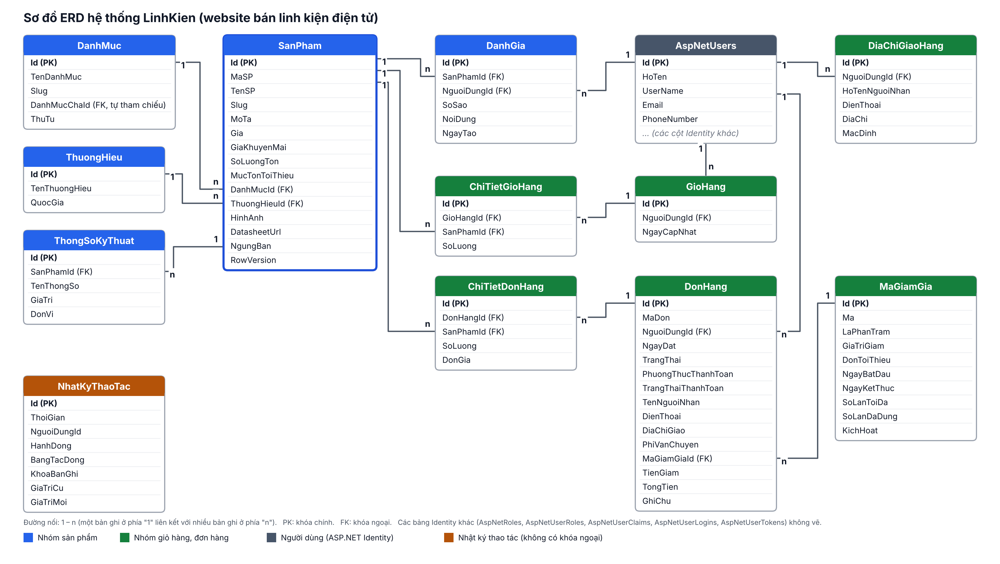

# LinhKien – Website bán linh kiện điện tử

> Đồ án tốt nghiệp: **Xây dựng website bán linh kiện điện tử trên nền tảng ASP.NET Core**

| Sinh viên | Bùi Tấn Tài |
| :---- | :---- |
| MSSV | 170125376 |
| Lớp | DK25TTC5 |
| Giảng viên hướng dẫn | TS. Nguyễn Nhứt Lam |
| Hạn hoàn thành | 13/12/2026 |
| Email liên hệ | [taibt120397@tvu-onschool.edu.vn](mailto:taibt120397@tvu-onschool.edu.vn) |
| Điện thoại | 0395917248 |
| Link demo (nếu có) | \[https\://...\] |

## 1\. Giới thiệu

Website giúp khách hàng tìm kiếm, lọc và đặt mua linh kiện điện tử (vi điều khiển, cảm biến, module, IC...) kèm thông số kỹ thuật và datasheet; giúp cửa hàng quản lý sản phẩm, tồn kho, đơn hàng và xem báo cáo doanh thu.

## 2\. Chức năng

**Khách hàng**

- [ ] Đăng ký, đăng nhập, quản lý hồ sơ và sổ địa chỉ  
- [ ] Xem, tìm kiếm, lọc, sắp xếp sản phẩm  
- [ ] Xem chi tiết sản phẩm (thông số, datasheet, đánh giá)  
- [ ] Giỏ hàng, đặt hàng, áp mã giảm giá  
- [ ] Theo dõi và hủy đơn hàng, đánh giá sản phẩm đã mua

**Quản trị (Admin, Nhân viên)**

- [ ] Quản lý danh mục, thương hiệu, sản phẩm, tồn kho  
- [ ] Xử lý đơn hàng theo trạng thái  
- [ ] Quản lý mã giảm giá, tài khoản và phân quyền (Admin)  
- [ ] Báo cáo doanh thu, sản phẩm bán chạy, xuất Excel  
- [ ] Nhật ký thao tác (Admin)

> Đánh dấu `[x]` khi hoàn thành từng chức năng.

## 3\. Công nghệ sử dụng

- ASP.NET Core MVC (.NET 10), Entity Framework Core (Code First)  
- SQL Server (stored procedure, view, trigger, transaction)  
- ASP.NET Core Identity (phân quyền theo vai trò)  
- Razor View, Bootstrap, jQuery, Chart.js  
- ClosedXML, X.PagedList

## 4\. Hướng dẫn cài đặt và chạy dự án

Phần này hướng dẫn từng bước để chạy được dự án trên một máy Windows chưa cài gì. Làm lần lượt từ 4.1 đến 4.6; nếu gặp lỗi, xem mục 4.7.

### 4.1. Yêu cầu môi trường

| Phần mềm | Phiên bản | Ghi chú |
| :---- | :---- | :---- |
| .NET SDK | 10.x | Tải tại <https://dotnet.microsoft.com/download>. Chọn **SDK** (không phải Runtime). |
| SQL Server | Express, Developer hoặc **LocalDB** | LocalDB có sẵn khi cài Visual Studio kèm workload ASP.NET. Hoặc cài SQL Server Express. |
| Công cụ EF Core (`dotnet-ef`) | Bản mới nhất | Cài ở bước 4.4. |
| Git | Bất kỳ | Chỉ cần nếu lấy mã nguồn bằng `git clone`. |
| SQL Server Management Studio (SSMS) | Bất kỳ | Tùy chọn, dùng để xem CSDL hoặc chạy file `.sql`. |
| Visual Studio | Bản hỗ trợ .NET 10 | Tùy chọn. Có thể chỉ dùng dòng lệnh. |

Kiểm tra đã cài đúng bằng cách mở **PowerShell** hoặc **Command Prompt** và gõ:

```sh
dotnet --version        # phải bắt đầu bằng 10.
sqllocaldb info         # nếu dùng LocalDB, phải thấy MSSQLLocalDB trong danh sách
```

Máy cần có kết nối Internet ở lần chạy đầu tiên để tải các gói NuGet (ClosedXML, X.PagedList...).

### 4.2. Lấy mã nguồn

**Cách A. Từ file nén (.zip) đã nộp**

1. Giải nén file `.zip` vào một thư mục, ví dụ `D:\LinhKien`. Tránh đường dẫn có dấu tiếng Việt hoặc quá dài.
2. Thư mục dự án nằm ở `src\LinhKien` (chứa file `LinhKien.csproj`). Thư mục `bin` và `obj` đã được xóa, sẽ tự được tạo lại khi chạy.

**Cách B. Từ GitHub**

```sh
git clone https://github.com/taibt120397-student/ASPNET-DK25TTC5-BuiTanTai-LinhKien.git
cd ASPNET-DK25TTC5-BuiTanTai-LinhKien/src/LinhKien
```

Từ các bước sau, mọi lệnh `dotnet` đều chạy **trong thư mục `src/LinhKien`** (thư mục có file `LinhKien.csproj`).

### 4.3. Cấu hình chuỗi kết nối

Mở file `src/LinhKien/appsettings.json`, sửa mục `ConnectionStrings:Default` cho khớp với SQL Server trên máy. Tên CSDL (`LinhKienDb` trong ví dụ) có thể đặt tùy ý, sẽ được tạo tự động ở bước 4.4.

**LocalDB** (đi kèm Visual Studio):

```json
"ConnectionStrings": {
  "Default": "Server=(localdb)\\MSSQLLocalDB;Database=LinhKienDb;Trusted_Connection=True;TrustServerCertificate=True"
}
```

**SQL Server Express** (đăng nhập bằng tài khoản Windows):

```json
"ConnectionStrings": {
  "Default": "Server=.\\SQLEXPRESS;Database=LinhKienDb;Trusted_Connection=True;TrustServerCertificate=True"
}
```

**SQL Server đăng nhập bằng tài khoản SQL** (ví dụ `sa`):

```json
"ConnectionStrings": {
  "Default": "Server=localhost;Database=LinhKienDb;User Id=sa;Password=<mật_khẩu_của_bạn>;TrustServerCertificate=True"
}
```

> Trong JSON, dấu `\` phải viết hai lần (`\\`). Không đưa mật khẩu thật lên GitHub.

### 4.4. Tạo cơ sở dữ liệu

Chọn **một trong hai cách**.

**Cách 1. Dùng EF Core Migration (khuyến nghị)**

```sh
# Chỉ cần cài một lần trên máy
dotnet tool install --global dotnet-ef

# Tạo CSDL, các bảng, stored procedure, trigger
dotnet ef database update
```

Kết thúc thành công sẽ có dòng `Done.` Lệnh này tạo toàn bộ bảng, `sp_DatHang`, `sp_HuyDonHang`, `trg_NhatKy_SanPham` và các bảng Identity.

**Cách 2. Chạy script SQL**

1. Mở SSMS, kết nối tới SQL Server (ví dụ `(localdb)\MSSQLLocalDB` hoặc `.\SQLEXPRESS`).
2. Chọn **File → Open → File...**, mở file `.sql` trong thư mục `setup/` của repository.
3. Nhấn **Execute** (phím `F5`) và chờ báo `Commands completed successfully`.
4. Kiểm tra trong Object Explorer đã có CSDL cùng tên với `Database=` trong chuỗi kết nối.

Dữ liệu mẫu (vai trò, tài khoản Admin) được nạp bởi `SeedData`. Nếu đã chạy script SQL thì không cần chạy migration nữa, và ngược lại.

### 4.5. Chạy ứng dụng

**Dùng dòng lệnh**

```sh
dotnet restore    # tải các gói NuGet (lần đầu)
dotnet run
```

Khi chạy thành công, terminal in ra các dòng dạng `Now listening on: https://localhost:xxxx`. Mở địa chỉ đó trong trình duyệt. Số cổng (port) cụ thể nằm trong `Properties/launchSettings.json`.

Nếu trình duyệt cảnh báo chứng chỉ HTTPS, chạy một lần lệnh sau rồi mở lại trình duyệt:

```sh
dotnet dev-certs https --trust
```

Muốn tự động nạp lại khi sửa code, dùng `dotnet watch run`. Nhấn `Ctrl + C` trong terminal để dừng ứng dụng.

**Dùng Visual Studio**

1. Mở file `src/LinhKien/LinhKien.csproj` (hoặc file `.sln` nếu có).
2. Nếu chọn cách tạo CSDL bằng migration: mở **Tools → NuGet Package Manager → Package Manager Console**, gõ `Update-Database`.
3. Nhấn `F5` (chạy có debug) hoặc `Ctrl + F5` (chạy không debug).

### 4.6. Đăng nhập thử và kiểm tra nhanh

**Tài khoản demo** (chỉ dùng để thử nghiệm)

| Vai trò | Email | Mật khẩu |
| :---- | :---- | :---- |
| Admin | [admin@shop.local](mailto:admin@shop.local) | \[mật khẩu trong SeedData\] |

Sau khi chạy, kiểm tra nhanh:

1. Trang chủ hiển thị được danh sách sản phẩm.
2. Đăng nhập bằng tài khoản Admin, vào được khu vực quản trị (danh mục, sản phẩm, đơn hàng).
3. Có thể đăng ký một tài khoản khách hàng mới và đặt thử một đơn hàng.

### 4.7. Các lỗi thường gặp

| Lỗi | Nguyên nhân và cách xử lý |
| :---- | :---- |
| `dotnet` không được nhận diện hoặc sai phiên bản | Chưa cài .NET 10 SDK. Cài xong, đóng và mở lại terminal, kiểm tra bằng `dotnet --list-sdks`. |
| `Could not execute because the specified command or file was not found` khi gõ `dotnet ef` | Chưa cài công cụ EF. Chạy `dotnet tool install --global dotnet-ef`, rồi mở lại terminal. |
| `A network-related or instance-specific error` hoặc `Cannot open database` | SQL Server chưa chạy hoặc sai `Server=` trong chuỗi kết nối. Mở `services.msc`, bật dịch vụ **SQL Server (SQLEXPRESS)**; với LocalDB chạy `sqllocaldb start MSSQLLocalDB`. |
| `The certificate chain was issued by an authority that is not trusted` | Thêm `TrustServerCertificate=True` vào chuỗi kết nối. |
| `Login failed for user` | Sai tên đăng nhập hoặc mật khẩu SQL, hoặc SQL Server chưa bật chế độ SQL authentication. Thử dùng Windows Authentication (`Trusted_Connection=True`). |
| Cổng đã được sử dụng (address already in use) | Đổi cổng bằng `dotnet run --urls "https://localhost:5002"` hoặc sửa trong `Properties/launchSettings.json`. |
| Lỗi migration (bảng đã tồn tại, CSDL lệch phiên bản) | Xóa CSDL rồi tạo lại: `dotnet ef database drop --force` sau đó `dotnet ef database update`. |
| Lỗi khôi phục gói NuGet khi build | Kiểm tra kết nối Internet, chạy lại `dotnet restore`. |

## 5\. Cấu trúc thư mục của repository

```
.
├── README.md             # tập tin này
├── src/                  # mã nguồn
│   └── LinhKien/         # project ASP.NET Core MVC
├── setup/                # script SQL, dữ liệu mẫu, hướng dẫn cài đặt, sơ đồ triển khai
├── progress-report/      # báo cáo tiến độ hàng tuần (tuan-01.md, tuan-02.md, ...)
├── docs/                 # hình ảnh dùng trong README (ERD, ảnh chụp màn hình)
├── thesis/               # tài liệu văn bản của đồ án
│   ├── doc/              # báo cáo dạng .docx
│   ├── pdf/              # báo cáo dạng .pdf
│   ├── abs/              # slide báo cáo, video demo
│   └── refs/             # tài liệu tham khảo
├── docker/               # (nếu có) Dockerfile, docker-compose
└── soft/                 # (nếu có) phần mềm liên quan
```

## 6\. Cơ sở dữ liệu

Danh sách bảng chính: `DanhMuc`, `ThuongHieu`, `SanPham`, `ThongSoKyThuat`, `GioHang`, `ChiTietGioHang`, `DiaChiGiaoHang`, `MaGiamGia`, `DonHang`, `ChiTietDonHang`, `DanhGia`, `NhatKyThaoTac` và các bảng Identity.

Đối tượng nâng cao: `sp_DatHang`, `sp_HuyDonHang`, `trg_NhatKy_SanPham` (tạo qua migration).

<p align="center">
  
  <br>
  <em>Hình 1. Sơ đồ ERD rút gọn (các bảng chính quanh SanPham)</em>
</p>

## 7\. Ảnh chụp màn hình

## 8\. Tiến độ thực hiện

| Tuần | Thời gian | Nội dung | Trạng thái |
| :---- | :---- | :---- | :---- |
| 1 | 02/11 – 08/11 | Đề cương, use case, ERD, khởi tạo project, Identity, migration | Đã hoàn thành |
| 2 | 09/11 – 15/11 | Danh mục, sản phẩm, upload ảnh, phân quyền | ☐ |
| 3 | 16/11 – 22/11 | Tìm kiếm, lọc, chi tiết sản phẩm, giỏ hàng | ☐ |
| 4 | 23/11 – 29/11 | Đặt hàng, thanh toán, mã giảm giá, quản lý đơn | ☐ |
| 5 | 30/11 – 06/12 | Đánh giá, báo cáo, nhật ký, kiểm thử | ☐ |
| 6 | 07/12 – 13/12 | Hoàn thiện báo cáo, slide, demo | ☐ |

Báo cáo từng tuần xem trong thư mục [`progress-report`](./progress-report).

## 9\. Tài liệu tham khảo

- Tài liệu ASP.NET Core và Entity Framework Core của Microsoft  
- Tài liệu SQL Server của Microsoft
