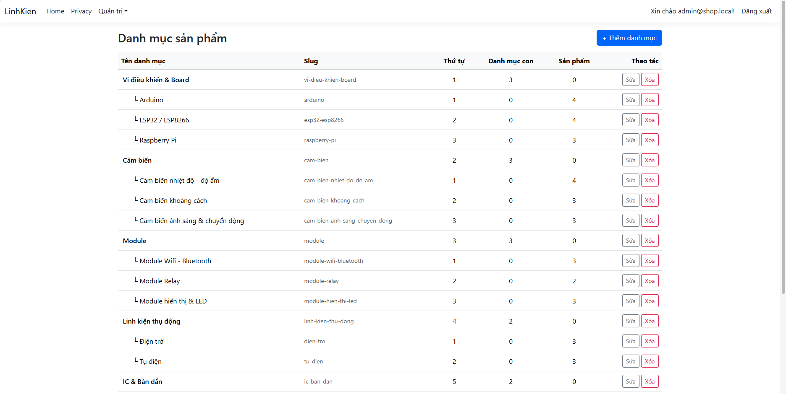
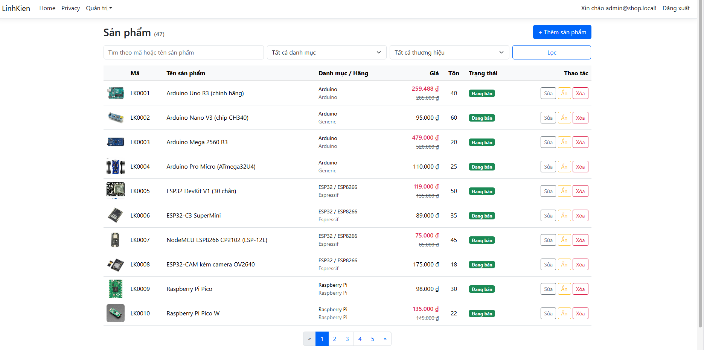
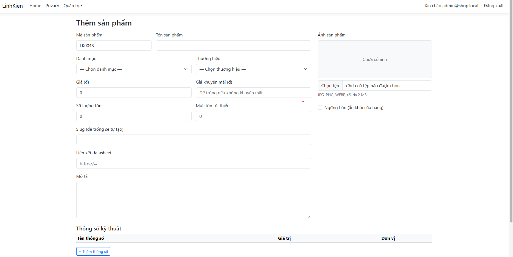
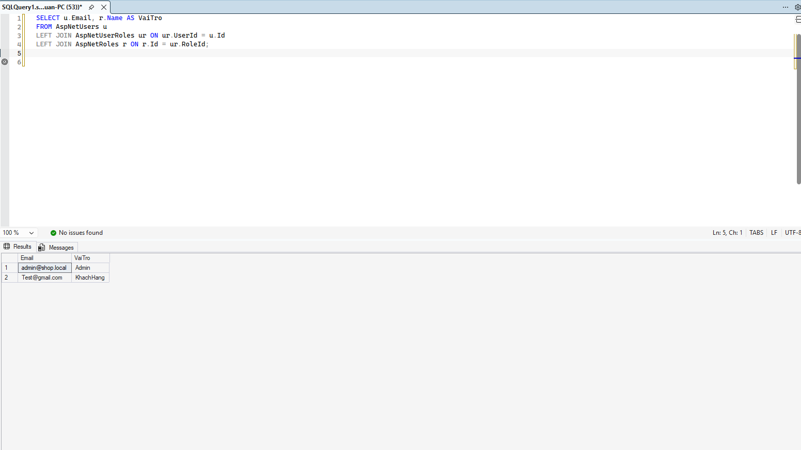

# Báo cáo tiến độ – Tuần 2

| Thông tin | Nội dung |
| :---- | :---- |
| Đề tài | Xây dựng website bán linh kiện điện tử trên nền tảng ASP.NET Core (LinhKien) |
| Sinh viên | Bùi Tấn Tài |
| MSSV | 170125376 |
| Lớp | DK25TTC5 |
| Giảng viên hướng dẫn | TS. Nguyễn Nhứt Lam |
| Thời gian báo cáo | Tuần 2 (09/11/2026 – 15/11/2026) |
| Repository | <https://github.com/taibt120397-student/ASPNET-DK25TTC5-BuiTanTai-LinhKien> |

## 1. Mục tiêu của tuần

Xây dựng khu vực quản trị danh mục, thương hiệu, sản phẩm và phân quyền theo vai trò, cụ thể:

- Quản lý danh mục (nhiều cấp), thương hiệu, sản phẩm kèm thông số kỹ thuật.
- Upload ảnh sản phẩm.
- Phân quyền khu vực quản trị theo vai trò; gán vai trò `KhachHang` khi khách đăng ký.
- Bổ sung dữ liệu mẫu vào `SeedData`.
- Viết Chương 1 – Tổng quan của báo cáo.

## 2. Công việc đã thực hiện

| STT | Công việc | Kết quả | Trạng thái |
| :---- | :---- | :---- | :---- |
| 1 | Quản lý danh mục (`QuanLyDanhMucController`) | Thêm, sửa, xóa danh mục dạng cây nhiều cấp (`DanhMucChaId`), tự tạo slug không dấu, chặn chọn danh mục cha là chính nó hoặc danh mục con của nó, chặn xóa khi còn danh mục con hoặc sản phẩm | Hoàn thành |
| 2 | Quản lý thương hiệu (`QuanLyThuongHieuController`) | Thêm, sửa, xóa thương hiệu; chặn trùng tên; chặn xóa khi còn sản phẩm | Hoàn thành |
| 3 | Quản lý sản phẩm (`QuanLySanPhamController`) | Danh sách có tìm theo mã/tên, lọc theo danh mục (gồm danh mục con) và thương hiệu, phân trang 10 dòng; thêm, sửa, ẩn/hiện, xóa sản phẩm; mã `LK0001`, `LK0002`... tự sinh ở máy chủ | Hoàn thành |
| 4 | Thông số kỹ thuật | Thêm/xóa nhiều dòng thông số ngay trên form sản phẩm (tên, giá trị, đơn vị) | Hoàn thành |
| 5 | Upload ảnh sản phẩm (`ImageService`) | Nhận `.jpg`, `.png`, `.webp` tối đa 2 MB, kiểm tra nội dung file, lưu vào `wwwroot/uploads/san-pham` với tên ngẫu nhiên, xóa ảnh cũ khi thay ảnh | Hoàn thành |
| 6 | Phân quyền | Các trang quản trị dùng `[Authorize(Roles = "Admin,NhanVien")]`; menu "Quản trị" chỉ hiện với `Admin`, `NhanVien`; tạo trang đăng ký riêng (scaffold Identity) để gán vai trò `KhachHang` khi khách đăng ký | Hoàn thành |
| 7 | Mở rộng `SeedData` (`CatalogSeeder`) | Nạp 21 danh mục (6 cha, 15 con), 14 thương hiệu, 47 sản phẩm kèm thông số kỹ thuật | Hoàn thành |
| 8 | Viết báo cáo | Hoàn thành Chương 1 – Tổng quan | Hoàn thành |

Mã nguồn đã được đẩy lên GitHub với commit "Them quan ly danh muc, thuong hieu, san pham, upload anh, phan quyen va seed du lieu".

## 3. Các quyết định kỹ thuật chính

| Nội dung | Cách thực hiện | Lý do |
| :---- | :---- | :---- |
| Tách model và form | Dùng ViewModel (`SanPhamFormVM`, `DanhMucFormVM`...) thay vì gắn trực tiếp entity vào form | Tránh người dùng gửi thêm trường không cho phép (over-posting), kiểm tra dữ liệu riêng cho từng màn hình |
| Mã sản phẩm | Sinh `LK` + số lớn nhất hiện có + 1 ở máy chủ, bỏ qua giá trị gửi từ form | Không cho người dùng tự đặt hoặc sửa mã; chỉ mục duy nhất của `MaSP` là lớp bảo vệ cuối |
| Slug | Hàm `SlugHelper` bỏ dấu tiếng Việt, kiểm tra trùng và thêm hậu tố `-2`, `-3` | Đường dẫn thân thiện, không bị trùng |
| Danh mục nhiều cấp | Đọc toàn bộ danh mục vào bộ nhớ rồi dựng cây (`DanhMucTree`) | Số danh mục ít, tránh truy vấn đệ quy nhiều lần; dùng chung cho lọc sản phẩm theo danh mục cha |
| Kiểm tra file ảnh | Kiểm tra đuôi file, dung lượng và 12 byte đầu của file (jpg, png, webp) | Chặn file độc hại đổi đuôi thành ảnh; tên file ngẫu nhiên tránh ghi đè và lộ tên gốc |
| Sửa đồng thời | Gán `RowVersion` lúc mở form làm giá trị gốc khi lưu | Hai người sửa cùng sản phẩm thì người lưu sau bị báo lỗi, không ghi đè mất dữ liệu |
| Xóa sản phẩm | Chặn xóa nếu sản phẩm đã có trong `ChiTietDonHang`, gợi ý dùng "Ẩn" | Giữ nguyên lịch sử đơn hàng (khớp `DeleteBehavior.Restrict` ở tuần 1) |
| Liên kết datasheet | Chỉ chấp nhận `http://` hoặc `https://` | Chặn liên kết dạng `javascript:` |
| Dữ liệu mẫu | `CatalogSeeder` chỉ chạy khi bảng `DanhMuc` còn trống | Chạy lại ứng dụng không bị nhân đôi dữ liệu |

## 4. Kết quả đạt được và tự kiểm tra

- [ ] Trang `/quan-tri/danh-muc` hiển thị cây danh mục đúng cấp
- [ ] Thêm, sửa, xóa thương hiệu; xóa thương hiệu còn sản phẩm bị chặn
- [ ] Thêm sản phẩm có thông số kỹ thuật và ảnh; mã tự sinh đúng
- [ ] Tìm kiếm, lọc theo danh mục và thương hiệu, phân trang hoạt động
- [ ] Upload file không phải ảnh hoặc quá 2 MB bị từ chối
- [ ] Tài khoản khách hàng vào `/quan-tri/...` bị chặn
- [ ] Khách đăng ký mới có vai trò `KhachHang` trong bảng `AspNetUserRoles`

**Hình ảnh minh chứng** (thêm ảnh vào thư mục `docs/` rồi chỉnh tên file cho khớp):

- Danh sách danh mục dạng cây: 

  
   
  <em>Hình 1. Danh sách danh mục</em>

- Danh sách sản phẩm, tìm kiếm và lọc: 

  
   
  <em>Hình 2. Danh sách sản phẩm</em>

- Form thêm sản phẩm kèm thông số kỹ thuật và ảnh: 

  
   
  <em>Hình 3. Form thêm sản phẩm</em>

- Vai trò của tài khoản trong SSMS (bảng `AspNetUserRoles`): 

  
   
  <em>Hình 4. Vai trò của người dùng</em>

## 5. Khó khăn và cách giải quyết

- **Build lỗi do tên `DbSet`:** `AppDbContext` đặt tên `ThongSos`, trong khi mã mới gọi `ThongSoKyThuats`. Giải quyết bằng cách đổi tên cho thống nhất (không ảnh hưởng cơ sở dữ liệu vì tên bảng đã cố định bằng `ToTable("ThongSoKyThuat")`).
- **Lệnh scaffold Identity không tạo ra thư mục `Areas`:** lệnh phải build project trước, nên lỗi biên dịch ở trên làm lệnh dừng. Sửa lỗi build rồi chạy lại thì tạo được trang đăng ký.
- **Khách đăng ký chưa có vai trò:** giao diện đăng ký mặc định của Identity nằm trong thư viện, không sửa được trực tiếp. Giải quyết bằng cách scaffold riêng trang `Register` và thêm lệnh `AddToRoleAsync(user, "KhachHang")` sau khi tạo tài khoản thành công.

## 6. Kế hoạch tuần 3 (16/11 – 22/11)

- Xây dựng trang chủ, danh sách sản phẩm, tìm kiếm và lọc cho khách hàng.
- Trang chi tiết sản phẩm (ảnh, giá, thông số kỹ thuật, tồn kho).
- Giỏ hàng.
- Viết Chương 2 – Nghiên cứu lý thuyết.

## 7. Nhận xét của giảng viên

