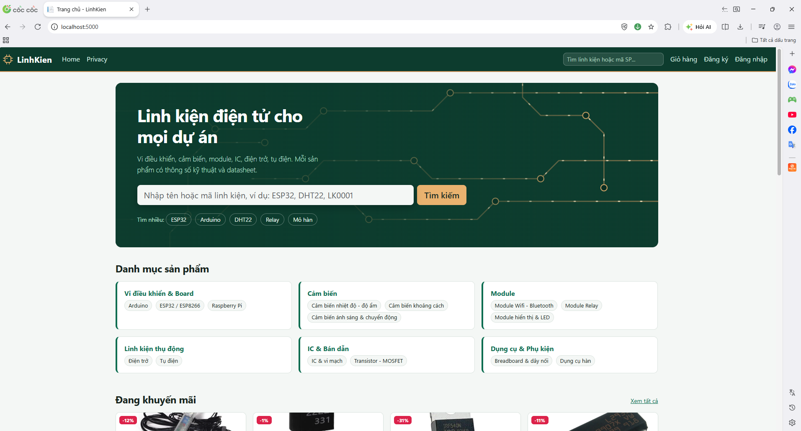
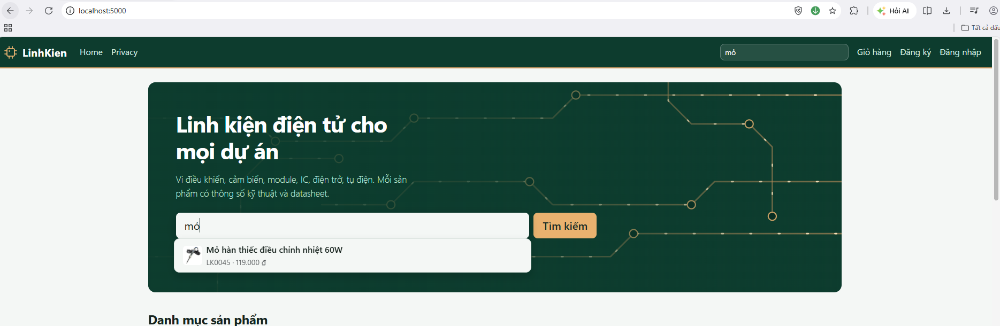
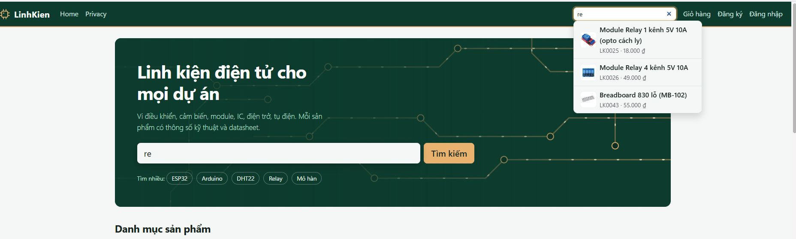
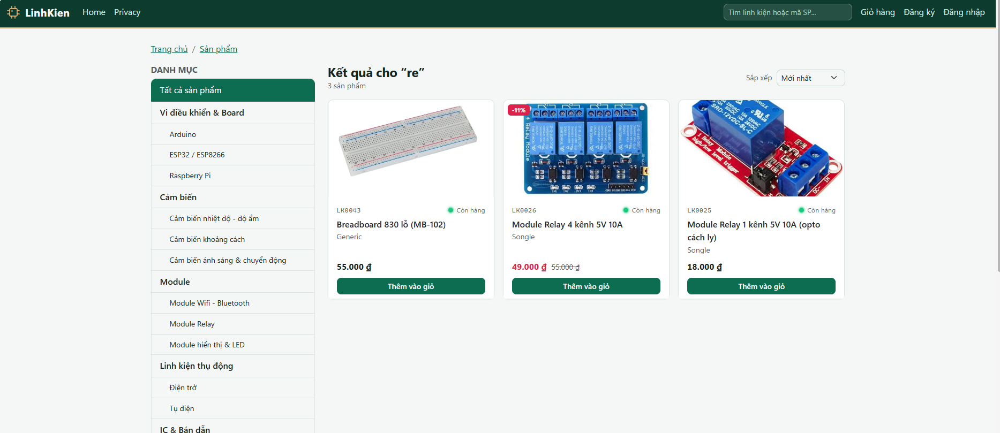
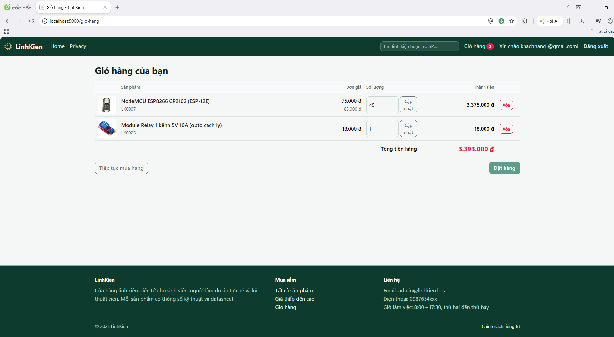
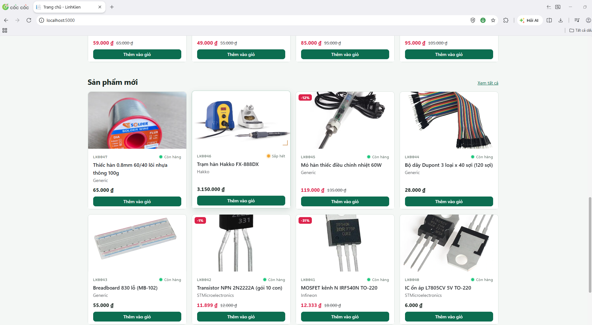

# Báo cáo tiến độ – Tuần 3

| Thông tin | Nội dung |
| :---- | :---- |
| Đề tài | Xây dựng website bán linh kiện điện tử trên nền tảng ASP.NET Core (LinhKien) |
| Sinh viên | Bùi Tấn Tài |
| MSSV | 170125376 |
| Lớp | DK25TTC5 |
| Giảng viên hướng dẫn | TS. Nguyễn Nhứt Lam |
| Thời gian báo cáo | Tuần 3 (16/11/2026 – 22/11/2026) |
| Repository | <https://github.com/taibt120397-student/ASPNET-DK25TTC5-BuiTanTai-LinhKien> |

## 1. Mục tiêu của tuần

Xây dựng phần giao diện dành cho khách hàng: duyệt, tìm kiếm, lọc sản phẩm và giỏ hàng, cụ thể:

- Trang chủ và danh sách sản phẩm có tìm kiếm, lọc, sắp xếp, phân trang.
- Gợi ý tìm kiếm ngay khi gõ.
- Trang chi tiết sản phẩm.
- Giỏ hàng gắn với tài khoản (thêm, sửa số lượng, xóa, kiểm tra tồn kho).
- Chỉnh giao diện chung của cửa hàng (chủ đề bo mạch in) và các hiệu ứng phản hồi thao tác.
- Viết Chương 2 – Nghiên cứu lý thuyết của báo cáo.

## 2. Công việc đã thực hiện

| STT | Công việc | Kết quả | Trạng thái |
| :---- | :---- | :---- | :---- |
| 1 | Trang chủ (`HomeController`) | Ô tìm kiếm lớn, danh mục cha kèm danh mục con, mục "Đang khuyến mãi" và "Sản phẩm mới" (8 sản phẩm mỗi mục) | Hoàn thành |
| 2 | Danh sách sản phẩm (`SanPhamController`) | Tìm theo tên hoặc mã; lọc theo danh mục (gồm danh mục con), thương hiệu, khoảng giá, "còn hàng", thông số kỹ thuật; sắp xếp theo mới nhất, giá, tên; phân trang 12 sản phẩm; chỉ hiện sản phẩm đang bán | Hoàn thành |
| 3 | Gợi ý tìm kiếm | Gõ từ 2 ký tự hiện tối đa 8 sản phẩm theo mã tăng dần (ảnh, tên, mã, giá); dùng được ở cả ô tìm kiếm trên menu và ô ở trang chủ | Hoàn thành |
| 4 | Chi tiết sản phẩm | Đường dẫn theo slug, breadcrumb theo danh mục, giá và phần trăm giảm, tình trạng tồn kho, bảng thông số, liên kết datasheet, sản phẩm liên quan | Hoàn thành |
| 5 | Giỏ hàng (`GioHangService`, `GioHangController`) | Thêm vào giỏ bằng AJAX kèm thông báo và số lượng trên menu; trang giỏ hàng cho sửa số lượng, xóa dòng, báo sản phẩm hết hàng hoặc ngừng bán; số lượng luôn bị giới hạn theo tồn kho | Hoàn thành |
| 6 | Chỉnh giao diện chung (`site.css`, `giao-dien.js`) | Chủ đề bo mạch in: thanh menu và chân trang xanh solder-mask có vệt đồng, banner trang chủ có đường mạch với dòng điện chạy chậm, mã linh kiện và bảng thông số dạng chữ đơn cách kiểu datasheet, đèn LED báo tồn kho (còn hàng, sắp hết, hết hàng) | Hoàn thành |
| 7 | Hiệu ứng phản hồi thao tác | Ảnh sản phẩm bay vào biểu tượng giỏ khi thêm hàng, số trên giỏ nảy lên, thẻ sản phẩm nhấc nhẹ khi rê chuột, ảnh chi tiết phóng to theo con trỏ; tự tắt khi hệ điều hành bật giảm chuyển động | Hoàn thành |
| 8 | Viết báo cáo | Chương 2 – Nghiên cứu lý thuyết | *(điền: Hoàn thành / Đang viết)* |

Mã nguồn đã được đẩy lên GitHub với commit "Them trang chu, danh sach, tim kiem, loc, chi tiet san pham, gio hang va giao dien".

## 3. Các quyết định kỹ thuật chính

| Nội dung | Cách thực hiện | Lý do |
| :---- | :---- | :---- |
| Giá khách phải trả | Lọc và sắp xếp theo `GiaKhuyenMai ?? Gia` (EF dịch thành `COALESCE`) | Giá lọc, giá sắp xếp và giá hiển thị luôn khớp nhau |
| Lấy dữ liệu danh sách | Chiếu (`Select`) thẳng vào `SanPhamCardVM` và dùng `AsNoTracking` | Chỉ lấy các cột cần hiển thị, nhanh hơn, EF không phải theo dõi thay đổi |
| Phân trang | `Skip/Take` chạy ở cơ sở dữ liệu, 12 sản phẩm mỗi trang | Không tải cả bảng lên bộ nhớ |
| Bộ lọc thông số | Giá trị cùng tên thông số là HOẶC, khác tên là VÀ; chỉ đưa ra các thông số có 2 đến 12 giá trị khác nhau | Lọc có ý nghĩa, tránh danh sách lựa chọn quá dài |
| Lọc theo danh mục cha | Dựng danh sách mã danh mục con cháu rồi `WHERE DanhMucId IN (...)` | Chọn danh mục cha vẫn thấy sản phẩm của danh mục con |
| Từ khóa tìm kiếm | Tách từng từ, mỗi từ phải khớp tên hoặc mã | Gõ "esp32 cam" vẫn ra "ESP32-CAM kèm camera OV2640" |
| Giữ bộ lọc khi sang trang | Dựng đường dẫn phân trang từ bộ lọc hiện tại | Bấm sang trang 2 không mất lựa chọn lọc |
| Sản phẩm bị ẩn | Trang chi tiết trả 404 với khách; danh sách, gợi ý đều bỏ qua | Ẩn là khách không thấy cũng không truy cập được bằng đường dẫn trực tiếp |
| Thêm vào giỏ bằng AJAX | Gửi `fetch` kèm token chống CSRF trong header; chưa đăng nhập thì máy chủ trả 401 và trình duyệt chuyển sang trang đăng nhập rồi quay lại | Thao tác không tải lại trang, vẫn an toàn |
| Chống sửa giỏ của người khác | Mọi thao tác sửa/xóa dòng giỏ đều lọc theo giỏ của người dùng đang đăng nhập | Không đổi được giỏ hàng bằng cách đổi mã dòng trên đường dẫn |
| Kiểm soát tồn kho trong giỏ | Số lượng thêm hoặc sửa bị giới hạn tối đa bằng `SoLuongTon`, kèm thông báo | Không cho đặt quá số hàng đang có |
| An toàn khi hiển thị gợi ý | JavaScript dùng `textContent` thay vì chèn HTML | Chặn XSS từ tên sản phẩm |
| Dùng lại thẻ sản phẩm | Một partial `_SanPhamCard` dùng cho trang chủ, danh sách và sản phẩm liên quan | Sửa một chỗ, đổi đồng loạt |
| Chủ đề giao diện | Màu, độ bo góc, phông đặt thành biến CSS ở đầu `site.css`; ghi đè biến của Bootstrap thay vì sửa tệp Bootstrap | Đổi bảng màu ở một chỗ, không phụ thuộc phiên bản Bootstrap |
| Phong cách bo mạch in | Banner dùng SVG nội tuyến (đường mạch, chân hàn) và hoạt ảnh `stroke-dashoffset` để tạo dòng điện chạy | Gắn với đặc thù linh kiện điện tử, không cần ảnh ngoài hay thư viện, nhẹ và không vỡ hình khi phóng to |
| Chữ đơn cách chỉ dùng cho dữ liệu kỹ thuật | Mã sản phẩm và giá trị trong bảng thông số dùng phông đơn cách; còn lại dùng phông hệ thống | Số liệu dễ đối chiếu, giao diện vẫn dễ đọc và không phải tải phông ngoài |
| Đèn LED tồn kho | So `SoLuongTon` với `MucTonToiThieu` để chọn màu xanh, vàng hoặc xám kèm chữ | Biết ngay tình trạng hàng, không chỉ dựa vào màu nên người khó phân biệt màu vẫn đọc được |
| Hiệu ứng phản hồi thao tác | Chỉ dùng hiệu ứng khi người dùng thao tác (thêm vào giỏ, rê chuột); không có hiệu ứng tự chạy khi cuộn trang; kiểm tra `prefers-reduced-motion` | Hiệu ứng giúp thấy kết quả thao tác mà không gây rối mắt, đáp ứng người dùng cần giảm chuyển động |
| Khả năng truy cập | Vòng viền focus rõ khi dùng bàn phím, thuộc tính `alt` và `aria-label` cho ảnh và ô tìm kiếm | Dùng được bằng bàn phím và trình đọc màn hình |

## 4. Kết quả đạt được và tự kiểm tra

- [x] Trang chủ hiển thị danh mục, sản phẩm khuyến mãi và sản phẩm mới
- [x] Gợi ý tìm kiếm hiện đúng ở cả ô trên menu và ô ở trang chủ
- [x] Tìm kiếm, lọc theo danh mục, thương hiệu, khoảng giá, còn hàng, thông số kỹ thuật hoạt động
- [x] Sắp xếp và phân trang đúng, giữ nguyên bộ lọc khi sang trang
- [x] Trang chi tiết hiển thị đủ ảnh, giá, tồn kho, thông số, datasheet, sản phẩm liên quan
- [x] Chưa đăng nhập bấm "Thêm vào giỏ" thì chuyển sang đăng nhập
- [x] Thêm, sửa số lượng, xóa trong giỏ hàng đúng; số lượng bị giới hạn theo tồn kho
- [x] Sản phẩm bị ẩn không còn hiện với khách
- [x] Giao diện mới hiển thị đúng trên máy tính và khi thu nhỏ cửa sổ về cỡ điện thoại
- [x] Hiệu ứng ảnh bay vào giỏ, số trên giỏ nảy lên, phóng to ảnh chi tiết hoạt động

**Hình ảnh minh chứng** (thêm ảnh vào thư mục `docs/` rồi chỉnh tên file cho khớp):

- Trang chủ (banner bo mạch in): 

  
   
  <em>Hình 1. Trang chủ</em>

- Gợi ý tìm kiếm khi gõ: 

  
   
  <em>Hình 2. Gợi ý tìm kiếm</em>

- Danh sách sản phẩm có bộ lọc: 

  
   
  <em>Hình 3. Danh sách sản phẩm và bộ lọc</em>

- Trang chi tiết sản phẩm: 

  
   
  <em>Hình 4. Chi tiết sản phẩm</em>

- Giỏ hàng: 

  
   
  <em>Hình 5. Giỏ hàng</em>

- Thẻ sản phẩm có đèn LED tồn kho và bảng thông số kiểu datasheet: 

  
   
  <em>Hình 6. Thẻ sản phẩm và đèn LED tồn kho</em>

## 5. Khó khăn và cách giải quyết

- **Gợi ý tìm kiếm không hiện:** ban đầu chỉ gắn gợi ý cho ô tìm kiếm trên menu, còn ô lớn ở trang chủ là ô khác nên không có. Giải quyết bằng cách viết lại JavaScript để áp dụng cho mọi ô có thuộc tính `data-goi-y`, nên thêm ô tìm kiếm mới chỉ cần thêm thuộc tính này.
- **Sửa giao diện nhưng trang không đổi:** file `.cshtml` được biên dịch lúc build nên sửa khi website đang chạy mà không build lại thì trình duyệt vẫn thấy bản cũ. Dùng công cụ F12 (Console, Network) để kiểm tra từng tầng, sau đó dừng hẳn website, build lại và xóa bộ nhớ đệm trình duyệt.
- **Chân trang mặc định đè lên nội dung:** mẫu giao diện có sẵn đặt chân trang cố định ở cuối cửa sổ với chiều cao 60 px, không phù hợp khi chân trang nhiều dòng. Giải quyết bằng cách đổi `body` thành bố cục cột (flex) để nội dung giãn ra và chân trang luôn nằm cuối trang.
- **Màu của Bootstrap lấn át giao diện mới:** nút, phân trang, ô chọn vẫn giữ màu xanh dương mặc định. Giải quyết bằng cách ghi đè các biến của Bootstrap (`--bs-btn-*`, `--bs-pagination-*`) thay vì thêm `!important` khắp nơi.
- **Tìm kiếm phân biệt dấu tiếng Việt:** gõ "mo" không ra "mỏ hàn" do cách so sánh chuỗi mặc định của SQL Server. Hiện giữ nguyên, ghi nhận để cải tiến sau nếu còn thời gian.

## 6. Kế hoạch tuần 4 (23/11 – 29/11)

- Đặt hàng bằng thủ tục `sp_DatHang` (kiểm tra tồn kho, tạo đơn, chốt đơn giá, trừ tồn kho, xóa giỏ trong một transaction).
- Địa chỉ giao hàng, phương thức thanh toán, phí vận chuyển.
- Mã giảm giá.
- Quản lý đơn hàng (xác nhận, giao, hoàn thành, hủy đơn hoàn tồn) và trang tài khoản khách hàng (theo dõi, hủy đơn).
- Viết Chương 3 – phần thiết kế (use case, sơ đồ hoạt động, sơ đồ trình tự, ERD, thiết kế bảng).

## 7. Nhận xét của giảng viên

