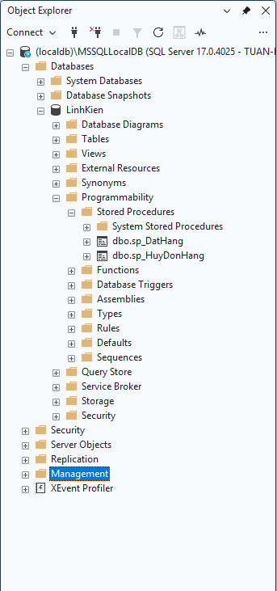
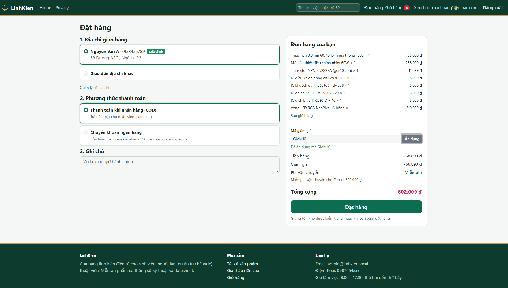
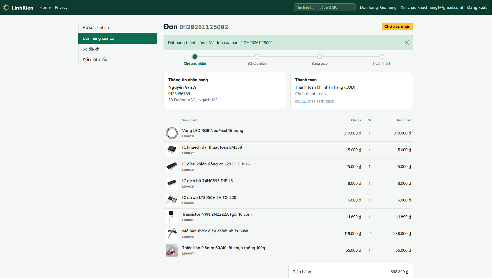
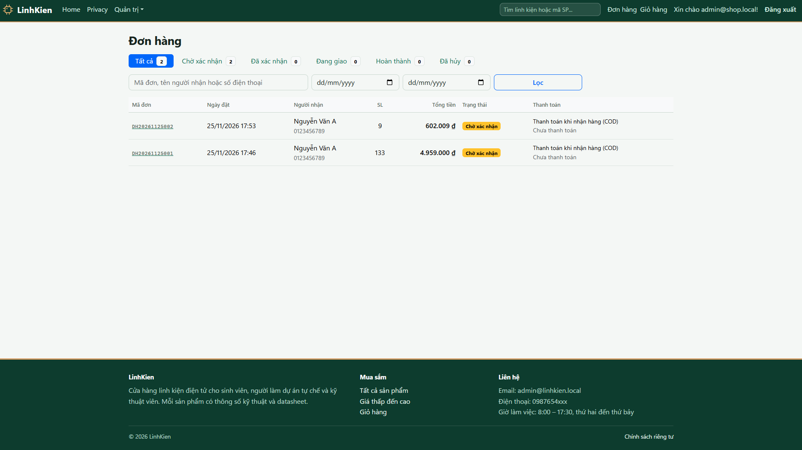
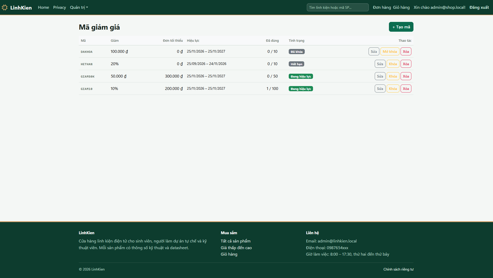
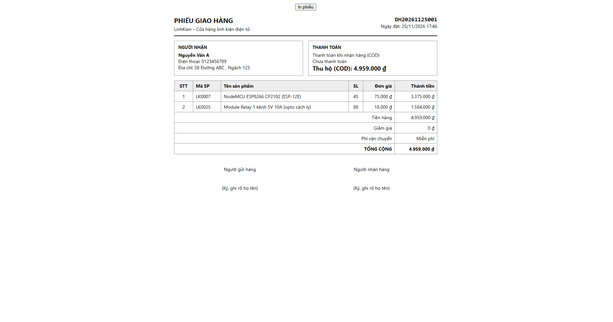

# Báo cáo tiến độ – Tuần 4

| Thông tin | Nội dung |
| :---- | :---- |
| Đề tài | Xây dựng website bán linh kiện điện tử trên nền tảng ASP.NET Core (LinhKien) |
| Sinh viên | Bùi Tấn Tài |
| MSSV | 170125376 |
| Lớp | DK25TTC5 |
| Giảng viên hướng dẫn | TS. Nguyễn Nhứt Lam |
| Thời gian báo cáo | Tuần 4 (23/11/2026 – 29/11/2026) |
| Repository | <https://github.com/taibt120397-student/ASPNET-DK25TTC5-BuiTanTai-LinhKien> |

## 1. Mục tiêu của tuần

Hoàn thiện quy trình mua hàng từ giỏ hàng đến giao hàng, cụ thể:

- Đặt hàng bằng thủ tục `sp_DatHang` (kiểm tra tồn kho, tạo đơn, trừ tồn, xóa giỏ trong một transaction).
- Thanh toán (COD, chuyển khoản), phí vận chuyển, mã giảm giá.
- Hủy đơn hoàn tồn bằng thủ tục `sp_HuyDonHang`.
- Quản lý đơn hàng cho nhân viên và tài khoản cho khách hàng.
- Viết Chương 3 – phần thiết kế (use case, sơ đồ hoạt động, sơ đồ trình tự, ERD, thiết kế bảng).

## 2. Công việc đã thực hiện

| STT | Công việc | Kết quả | Trạng thái |
| :---- | :---- | :---- | :---- |
| 1 | Thủ tục `sp_DatHang` | Trong một transaction: khóa dòng sản phẩm (`UPDLOCK`) và kiểm tra tồn, áp mã giảm giá, tính phí vận chuyển, tạo `DonHang` và `ChiTietDonHang` (chốt đơn giá), trừ tồn, tăng `SoLanDaDung`, xóa giỏ; thiếu hàng thì rollback và trả về danh sách sản phẩm không đủ; sinh mã đơn dạng `DH` + ngày + số thứ tự | Hoàn thành |
| 2 | Thủ tục `sp_HuyDonHang` | Đổi trạng thái sang đã hủy, hoàn `SoLuongTon` từng dòng và hoàn một lượt dùng mã giảm giá trong cùng một transaction; khách chỉ hủy được đơn của mình khi chưa giao | Hoàn thành |
| 3 | Trang đặt hàng (`DatHangController`) | Chọn địa chỉ từ sổ địa chỉ hoặc nhập mới (có thể lưu lại), chọn COD hoặc chuyển khoản (hiện thông tin ngân hàng), nhập mã giảm giá và xem trước tiền giảm, phí vận chuyển, tổng cộng bằng AJAX; chặn bấm đặt hàng hai lần | Hoàn thành |
| 4 | Mã giảm giá (`QuanLyMaGiamGiaController`) | Admin tạo, sửa, khóa, mở khóa mã (giảm theo phần trăm hoặc số tiền, đơn tối thiểu, thời gian hiệu lực, số lần dùng tối đa); mã đã dùng thì không xóa được; nạp 4 mã mẫu | Hoàn thành |
| 5 | Quản lý đơn hàng (`QuanLyDonHangController`) | Danh sách có thẻ trạng thái kèm số lượng, tìm theo mã, tên, số điện thoại, lọc theo ngày, phân trang; chuyển trạng thái từng bước; xác nhận đã nhận tiền chuyển khoản; hủy đơn hoàn tồn; in phiếu giao hàng | Hoàn thành |
| 6 | Tài khoản khách hàng (`TaiKhoanController`) | Hồ sơ cá nhân, sổ địa chỉ (thêm, sửa, đặt mặc định, xóa), danh sách đơn có lọc theo trạng thái, chi tiết đơn có thanh tiến trình, hủy đơn khi chưa giao | Hoàn thành |
| 7 | Nhật ký thao tác | Đổi trạng thái đơn, hủy đơn, xác nhận thanh toán được ghi vào bảng `NhatKyThaoTac` | Hoàn thành |
| 8 | Viết báo cáo | Chương 3 – phần thiết kế | *(điền: Hoàn thành / Đang viết)* |

Mã nguồn đã được đẩy lên GitHub với commit "Them dat hang, sp_DatHang, ma giam gia, quan ly don hang va tai khoan khach hang".

## 3. Các quyết định kỹ thuật chính

| Nội dung | Cách thực hiện | Lý do |
| :---- | :---- | :---- |
| Đặt hàng bằng thủ tục lưu sẵn | Toàn bộ bước tạo đơn nằm trong `sp_DatHang`, ứng dụng chỉ gọi và đọc kết quả qua tham số `OUTPUT` | Kiểm tra tồn, trừ tồn và tạo đơn nằm trong một transaction ngay tại cơ sở dữ liệu, không bị lệch nếu ứng dụng lỗi giữa chừng |
| Chống bán quá tồn | Khóa dòng sản phẩm bằng `UPDLOCK, ROWLOCK` trước khi kiểm tra tồn | Hai khách cùng mua sản phẩm cuối cùng thì chỉ một đơn thành công, đơn còn lại báo không đủ số lượng |
| Chốt đơn giá | Lưu `DonGia = GiaKhuyenMai ?? Gia` vào `ChiTietDonHang` lúc đặt | Đổi giá sản phẩm sau này không làm thay đổi đơn cũ |
| Kiểm tra mã giảm giá hai lần | Ứng dụng kiểm tra để xem trước, `sp_DatHang` kiểm tra lại và khóa dòng mã trong transaction | Xem trước nhanh, còn kết quả cuối cùng không phụ thuộc dữ liệu cũ; hai đơn không cùng dùng lượt cuối của mã |
| Phí vận chuyển | Tham số `@PhiCoDinh`, `@NguongMienPhi` đọc từ `appsettings.json`, thủ tục tự quyết định miễn phí hay không | Đổi chính sách vận chuyển không cần sửa thủ tục; kết quả tính trên tiền hàng thật trong transaction |
| Mã đơn | `DH` + `yyyyMMdd` + số thứ tự trong ngày, tính trong transaction có khóa dải; chỉ mục duy nhất của `MaDon` là lớp bảo vệ cuối | Mã dễ đọc, dễ tra cứu, không trùng khi nhiều người đặt cùng lúc |
| Vòng đời đơn | Chỉ cho chuyển theo thứ tự Chờ xác nhận → Đã xác nhận → Đang giao → Hoàn thành; cập nhật có điều kiện trạng thái cũ (`ExecuteUpdate ... Where TrangThai == cũ`) | Hai nhân viên bấm cùng lúc thì chỉ một thao tác có hiệu lực, không nhảy cóc trạng thái |
| Đơn đã hoàn thành | Không cho sửa hay hủy | Đúng yêu cầu của đề cương: đơn hoàn thành là dữ liệu đã chốt |
| Chuyển khoản | Nhân viên xác nhận đã nhận tiền, và phải xác nhận trước khi chuyển sang đang giao; COD tự thành "đã thanh toán" khi hoàn thành | Chỉ giao hàng khi đã chắc chắn nhận được tiền với đơn chuyển khoản |
| Phân quyền theo vai trò | Quản lý đơn cho Admin và Nhân viên; quản lý mã giảm giá chỉ Admin; khách chỉ truy cập đơn và địa chỉ của chính mình (lọc theo mã người dùng) | Đổi số `id` trên đường dẫn sang đơn của người khác chỉ nhận về 404 |
| Hủy đơn không để lộ thông tin | Khách hủy đơn của người khác nhận cùng thông báo "không tìm thấy" như đơn không tồn tại | Không cho dò xem đơn nào có tồn tại |
| Khóa mã thay vì xóa | Mã đã được dùng thì chỉ khóa, không xóa | Giữ nguyên lịch sử các đơn đã dùng mã |
| Đóng gói thủ tục thành migration | Thủ tục nằm trong file migration và trong thư mục `setup/` dưới dạng `.sql` | Chạy `database update` là tạo được, đồng thời có script riêng để nộp theo đề cương |

## 4. Kết quả đạt được và tự kiểm tra

- [ ] Đặt hàng thành công: giỏ trống, tồn kho giảm, mã đơn đúng định dạng
- [ ] Phí vận chuyển đúng (30.000₫, miễn phí từ 500.000₫)
- [ ] Mã giảm giá: dùng được mã hợp lệ; báo lỗi đúng với mã hết hạn, bị khóa, chưa đạt đơn tối thiểu
- [ ] Hai khách cùng mua sản phẩm cuối cùng: chỉ một đơn thành công
- [ ] Khách hủy đơn chưa giao: tồn kho được hoàn lại; đơn đang giao không hủy được
- [ ] Nhân viên chuyển trạng thái đúng thứ tự, đơn hoàn thành không sửa được
- [ ] Đơn chuyển khoản chưa xác nhận tiền thì không chuyển sang đang giao được
- [ ] In phiếu giao hàng
- [ ] Khách không vào được trang quản trị; nhân viên không vào được trang mã giảm giá

**Hình ảnh minh chứng** (thêm ảnh vào thư mục `docs/` rồi chỉnh tên file cho khớp):

- Hai stored procedure trong SSMS: 

  
   
  <em>Hình 1. Thủ tục sp_DatHang và sp_HuyDonHang</em>

- Trang đặt hàng với mã giảm giá: 

  
   
  <em>Hình 2. Trang đặt hàng</em>

- Chi tiết đơn của khách có thanh tiến trình: 

  
   
  <em>Hình 3. Chi tiết đơn hàng</em>

- Quản lý đơn hàng của nhân viên: 

  
   
  <em>Hình 4. Quản lý đơn hàng</em>

- Quản lý mã giảm giá: 

  
   
  <em>Hình 5. Quản lý mã giảm giá</em>

- Phiếu giao hàng: 

  
   
  <em>Hình 6. Phiếu giao hàng</em>

## 5. Khó khăn và cách giải quyết

- **Chưa cài công cụ `dotnet-ef`:** lệnh `dotnet ef migrations list` báo không tìm thấy lệnh. Chuyển sang dùng cửa sổ Package Manager Console của Visual Studio.
- **Package Manager Console dừng vì cảnh báo bảo mật mức thấp:** cảnh báo `NU1901` về gói `NuGet.Packaging` làm lệnh `Get-Migration` dừng dù build thành công. Giải quyết bằng cách tạo hai thủ tục trực tiếp trong SSMS từ các file trong thư mục `setup/`; thủ tục dùng `CREATE OR ALTER` nên chạy lại hay chạy qua migration sau này đều không bị lỗi.
- **Lỗi cú pháp `appsettings.json`:** khi thêm mục cấu hình cửa hàng, ứng dụng không khởi động vì thiếu dấu phẩy giữa hai mục JSON. Sửa lại đúng cú pháp và kiểm tra bằng cách chạy lại ứng dụng.
- **Nhầm lẫn giữa bảng và thủ tục trong SSMS:** thủ tục lưu sẵn không nằm trong mục Tables mà nằm trong Programmability → Stored Procedures.

## 6. Kế hoạch tuần 5 (30/11 – 06/12)

- Đánh giá sản phẩm (chấm sao, nhận xét; chỉ khách đã mua mới được đánh giá).
- Dashboard và báo cáo: doanh thu theo ngày và tháng, sản phẩm bán chạy, sản phẩm tồn kho thấp.
- Nhật ký thao tác (trigger ghi thay đổi sản phẩm, màn hình xem nhật ký) và quản lý người dùng cho Admin.
- Xuất hóa đơn: khách có thể yêu cầu xuất hóa đơn khi đặt hàng (tên đơn vị, mã số thuế, địa chỉ, email nhận hóa đơn); hệ thống ghi nhận thông tin xuất hóa đơn của từng đơn, nhân viên xuất hóa đơn (số hóa đơn, ngày xuất) và in hoặc tải bản hóa đơn.
- Kiểm thử và sửa lỗi; khóa code ngày 06/12.
- Viết Chương 3 (phần cài đặt) và Chương 4.

## 7. Nhận xét của giảng viên

